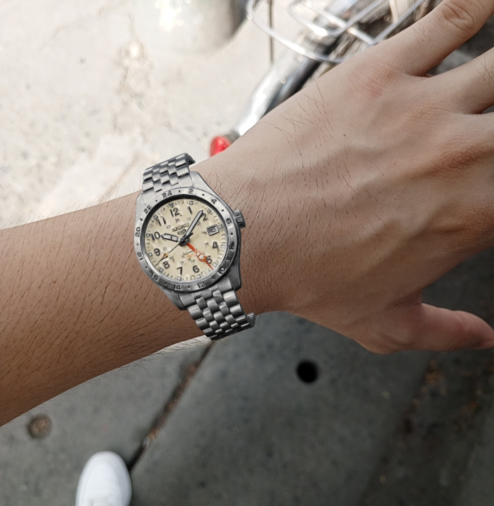
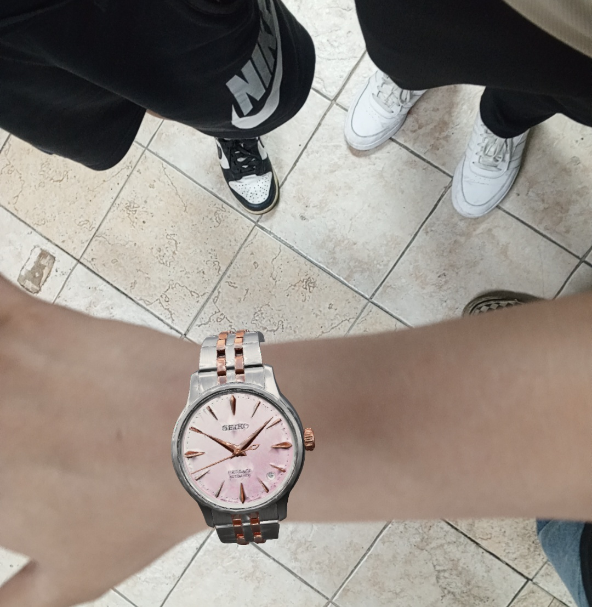
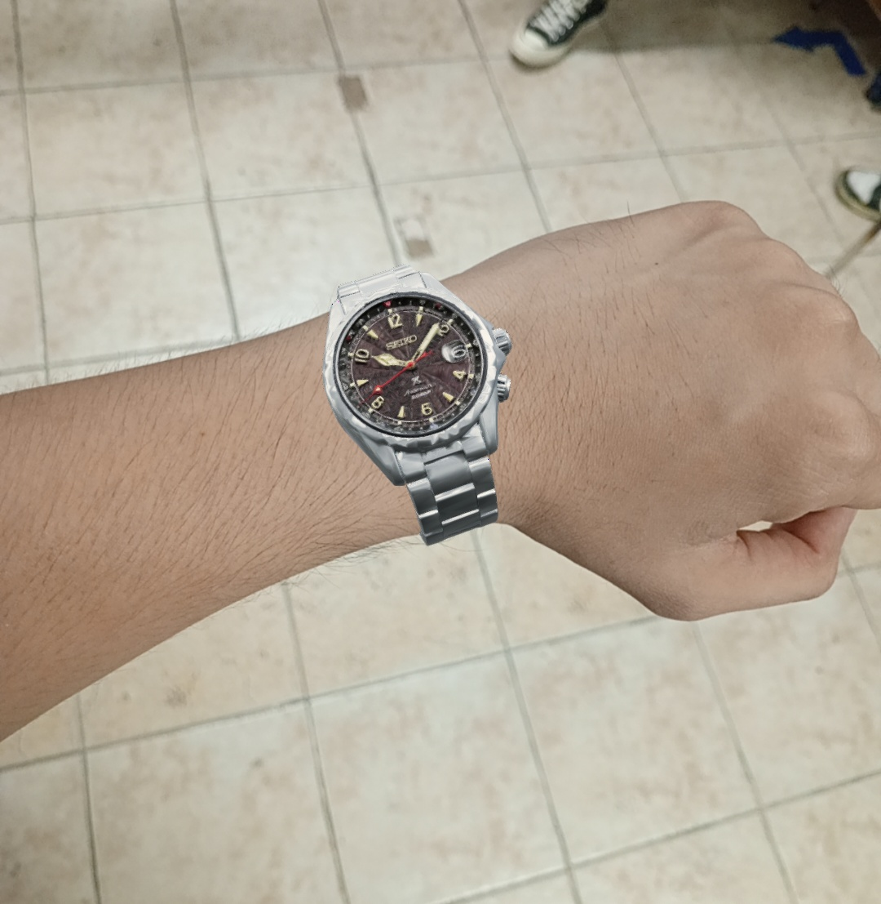
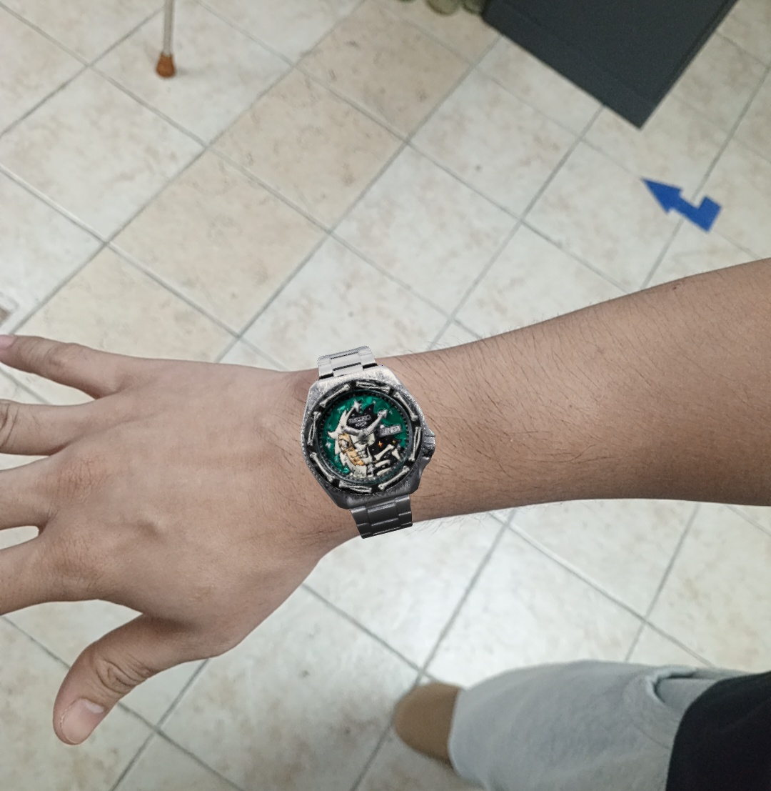
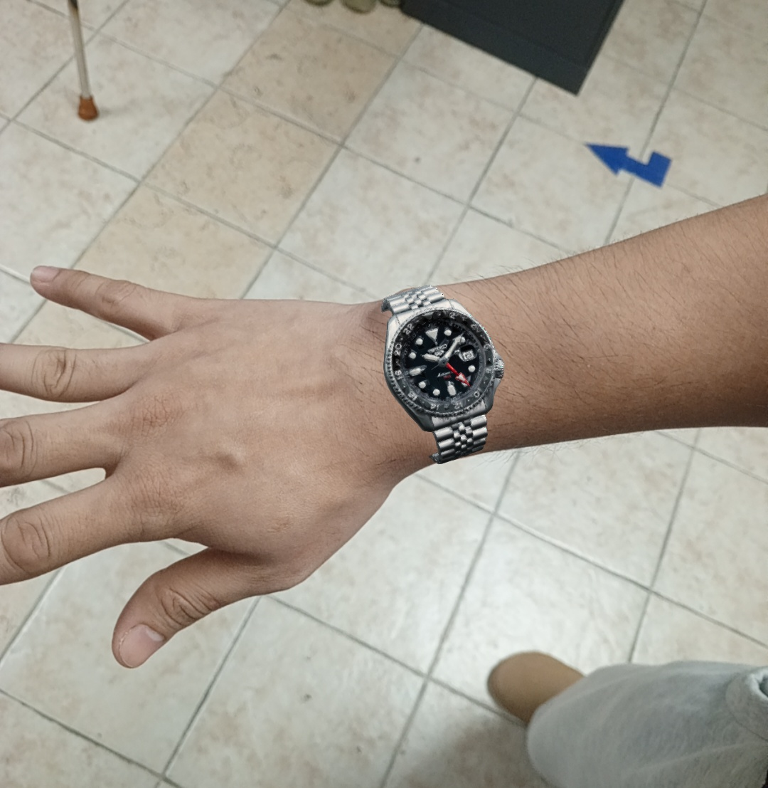

# VirtuWatch

AI-assisted virtual watch try-on and fit-recommendation app, built for Urbane Time. Customers can try watches on in AR, get a wrist measurement without a camera, and receive AI-scored recommendations based on fit, color, and style, with a Gemini-backed chat assistant to help them decide. Merchants and admins manage the catalog, accounts, and analytics through a Vue web portal.

VirtuWatch has two parts that share one Firebase backend:

| Part | Folder | Stack | Users |
| --- | --- | --- | --- |
| Mobile app (Android) | `/` (`lib/`, `android/`) | Flutter, Kotlin, Filament, MediaPipe | Customers, merchants, admins |
| Web portal | `admin-web/` | Vue 3, Vite, Tailwind CSS | Merchants, admins |

The intended platform for the mobile app is **Android**. The AR try-on is native Kotlin, so the other Flutter platform folders (iOS, macOS, Windows, Linux) are default scaffolding only.

## AR Try-On Previews

Photos captured with the in-app AR try-on. Customers can take a photo while trying a watch on, preview it, and share it.

<table>
  <tr>
    <td align="center"></td>
    <td align="center"></td>
    <td align="center"></td>
  </tr>
  <tr>
    <td align="center"></td>
    <td align="center"></td>
  </tr>
</table>

## Features

### Customer (mobile app)
- **AR try-on**: live, markerless AR watch try-on using on-device hand-landmark tracking (no ARCore/ARKit dependency, so it works without an ARCore-certified device). The watch is sized and centered to the forearm measured in the camera image, and a depth-only occluder hides the part of the strap that passes behind the wrist.
- **Wrist measurement, no camera**: a direct on-screen comparison. Rest your wrist above or below the phone, line it up against a fixed reference line, and adjust a second line (via tap/hold step buttons or an optional drag slider) until it matches your wrist's edge. Requires a one-time per-device screen calibration against a real card or a ₱20 coin, since phones can't be trusted to self-report their screen density accurately. Manual entry is always available as a fallback.
- **Outfit color scanning**: scans an outfit photo to extract dominant colors for style-matched recommendations.
- **AI-scored recommendations** ("For You"): watches ranked by a weighted blend of Fit (55%, lug-to-lug as a proportion of wrist width), Style (30%, category match), and Color (15%, outfit vs. watch color). Missing signals are excluded and the remaining weights are rebalanced rather than penalizing an incomplete profile. Budget range is tracked separately as a hard affordability label, not part of the score.
- **Chat assistant**: a Gemini-backed assistant, scoped to either a single watch or the customer's recommendation list, grounded with the same fit and score data shown in the UI so it can't contradict what's on screen.
- Saved/wishlist watches, style preferences, profile management.

### Merchant (mobile app and web portal)
- Add and edit watch listings, with images and 3D models hosted on Cloudinary.
- Catalog management and watch detail pages.
- Sales and engagement analytics (saves and views per listing).
- Profile management.

### Admin (mobile app and web portal)
- Account management: create accounts, disable or re-enable them, change roles, and delete accounts.
- Catalog moderation across all merchants, including adding or editing a watch on behalf of a merchant.
- AR fit entry: an admin measures and enters the strap-opening numbers (`holeCx`, `holeHalfX`, `holeHalfY`, optional `scale`) that let a 3D model sit correctly on the wrist. Merchants cannot set these, and the Firestore rules enforce that.
- Dashboard with health panels for items that need attention, plus a live recent-activity feed.

## Web Portal (`admin-web/`)

A Vue 3 single-page app for merchants and admins who prefer to manage listings from a desktop browser. It talks to the same Firebase project as the mobile app, so changes appear in the app immediately. It is live at https://virtuwatch.web.app.

### Routes

| Role | Pages |
| --- | --- |
| Public | Sign in, forgot password |
| Admin (`/admin`) | Dashboard, watches (list, add, edit, detail), accounts (list, create), profile |
| Merchant (`/merchant`) | Dashboard, catalog, add and edit watch, watch detail, analytics, profile |

Routes are guarded by role, so a merchant cannot open admin pages and the other way around. Access is also enforced on the backend by `firestore.rules`.

### Tech
- **Vue 3** (`<script setup>`) with **Vue Router**
- **Vite** for dev server and build
- **Tailwind CSS v4** for styling
- **Firebase** Authentication and Firestore (same project as the app)
- **Cloudinary** for image and 3D model (`.glb`) uploads, capped at 10 MB per model on the free plan
- **Firebase Hosting** and **GitHub Actions** for hosting and automatic deploys

### Running the web portal

Prerequisites: Node.js 20 or newer, and the same Firebase project used by the mobile app.

1. Go into the portal folder and install dependencies:
   ```
   cd admin-web
   npm install
   ```
2. Copy `.env.example` to `.env.local` and fill in the values from your Firebase project settings (Project settings > General > Your apps > Web app):
   ```
   VITE_FIREBASE_API_KEY=
   VITE_FIREBASE_AUTH_DOMAIN=
   VITE_FIREBASE_PROJECT_ID=
   VITE_FIREBASE_STORAGE_BUCKET=
   VITE_FIREBASE_MESSAGING_SENDER_ID=
   VITE_FIREBASE_APP_ID=
   ```
   `.env.local` is gitignored, so your real values stay on your machine.
3. Start the dev server:
   ```
   npm run dev
   ```
4. Build for production:
   ```
   npm run build
   npm run preview   # optional: preview the production build locally
   ```

Uploads use an unsigned Cloudinary preset. If you use your own Cloudinary account, update the cloud name and upload preset in `admin-web/src/services/cloudinaryService.js` and in `lib/services/cloudinary_service.dart`.

Accounts are created by an admin, either from the web portal or the mobile app. Customers register themselves in the mobile app.

### Deploying the web portal

The portal is hosted on **Firebase Hosting**, in the same Firebase project as the app, at https://virtuwatch.web.app (site ID `virtuwatch`). The hosting settings are in the root `firebase.json`. The portal is a single-page app, so every path is rewritten to `index.html`. That is what keeps a page refresh on a route like `/admin/watches` from showing a 404.

**Automatic deploys.** Every push to `main` runs the workflow in `.github/workflows/firebase-hosting-merge.yml`. It installs dependencies, builds `admin-web`, and deploys the result to the live site. Pushes to `dev` do not deploy. The workflow needs these repository secrets (GitHub repo > Settings > Secrets and variables > Actions):

- `FIREBASE_SERVICE_ACCOUNT_VIRTUWATCH_711E4`: lets GitHub deploy to Firebase Hosting. It is created by `firebase init hosting:github`.
- `VITE_FIREBASE_API_KEY`, `VITE_FIREBASE_AUTH_DOMAIN`, `VITE_FIREBASE_PROJECT_ID`, `VITE_FIREBASE_STORAGE_BUCKET`, `VITE_FIREBASE_MESSAGING_SENDER_ID`, `VITE_FIREBASE_APP_ID`: the same values as in `admin-web/.env.local`. They are baked into the build, so if one is missing or wrong, sign-in on the live site will fail.

**Manual deploys.** Install the Firebase CLI (`npm install -g firebase-tools`) and sign in with `firebase login`. Then:
```
cd admin-web
npm install
npm run build
cd ..
firebase deploy --only hosting --project virtuwatch-711e4
```

**Using a different Firebase project or site.** Create the site with `firebase hosting:sites:create <site-id>`. Then update the site name in `firebase.json` (`hosting.site`), the project ID in `.firebaserc` and in the workflow (`projectId`), and the service account secret name in the workflow. Check that the new domain is listed under Authentication > Settings > Authorized domains in the Firebase console, or sign-in will fail.

### Keeping the app and portal in sync

`admin-web/src/utils/arFit.js` is a JavaScript port of `lib/utils/ar_readiness.dart`. The app decides whether a watch appears in AR using the Dart version, so if you change the validation rules in one, change the other too.

## Tech Stack

- **Flutter** (Android is the supported target for the mobile app)
- **Kotlin, Filament, and MediaPipe** for the native AR try-on (rendering, hand tracking, and forearm detection)
- **Vue 3, Vite, and Tailwind CSS** for the web portal
- **Firebase Hosting and GitHub Actions**: host the web portal and deploy it on every push to `main`
- **Firebase**: Authentication and Firestore (data is read and written as raw `Map<String, dynamic>` in the app; there's no separate model layer)
- **Google Gemini (via Firebase AI Logic)**: powers the in-app chat assistant
- **MediaPipe (`hand_landmarker`)**: on-device hand tracking for AR try-on
- **Cloudinary**: merchant-uploaded watch image and 3D model hosting

## Getting Started (Mobile App)

### Prerequisites
- Flutter SDK (Dart `^3.11.0` per `pubspec.yaml`)
- A Firebase project with Authentication and Firestore enabled, and `google-services.json` placed under `android/app/`
- Firebase AI Logic turned on for your Firebase project, using the Gemini Developer API (no API key goes in this app)

### Setup
1. Clone the repo and run `flutter pub get`.
2. In the Firebase console, open Firebase AI Logic, choose the Gemini Developer API, and finish the setup. The key stays on Google's side.
3. Deploy the security rules in `firestore.rules` to your Firestore database.
4. Run the app:
   ```
   flutter run
   ```

App Check is required for the chat assistant. On the first debug run, look in the run logs for the App Check debug token, then add it in the Firebase console under App Check > Apps > Manage debug tokens. Without it, chat requests are rejected. Release builds use Play Integrity, so the app must be registered with App Check before real users get it.

### Building a release APK

First time only: generate your own release keystore (keep this file and its passwords private, and back them up somewhere safe, since a lost Play Store upload key can't be recovered or swapped later):
```
keytool -genkey -v -keystore ~/upload-keystore.jks -keyalg RSA -keysize 2048 -validity 10000 -alias upload
```
Then copy `android/key.properties.example` to `android/key.properties` and fill in the passwords, alias, and the path to the `.jks` file you just created. `android/key.properties` is gitignored, so it stays local.

```
flutter build apk --release
```

If `android/key.properties` isn't present yet, the release build falls back to the debug keystore so the command above still works while you're setting things up. It is just not suitable for real distribution until the keystore is in place.

## Project Structure

```
lib/                  # Flutter mobile app
  screens/
    customer/         # catalog, AR try-on, wrist measurement, outfit scan, recommendations, profile
    merchant/         # listings, analytics, profile
    admin/            # account management, catalog moderation, dashboard
  services/           # business logic: recommendation scoring, chat, auth, etc.
  widgets/            # shared UI (e.g. EdgeMatchGuide, OffsetStepperControl, used by both the
                      # wrist measurement and screen calibration screens)
  constants/          # app_knowledge.dart (grounds the chat assistant), watch_colors.dart
  theme/              # app-wide styling
  utils/              # pure logic (fit scoring, recommendation scoring, validators), unit tested

android/app/src/main/kotlin/com/urbanetime/virtuwatch/
                      # native AR try-on
                      #   HandTracker       camera + MediaPipe hand landmarks
                      #   WristPose         wrist pose from landmarks
                      #   ArmAxis           forearm direction and width from the camera image
                      #   WatchRenderer     Filament rendering of the 3D watch
                      #   OneEuroFilter     pose smoothing

admin-web/            # Vue 3 web portal for merchants and admins
  src/
    views/            # admin/, merchant/, and shared pages
    components/       # shared UI (forms, cards, dialogs, toasts)
    layouts/          # AdminLayout, MerchantLayout
    services/         # Firebase and Cloudinary access
    composables/      # auth, catalog query, toasts, transitions
    router/           # role-guarded routes
    utils/            # arFit, validators, catalog filters

test/                 # Dart unit tests
firestore.rules       # security rules shared by the app and the portal
firebase.json         # Firebase config: Firestore rules and Hosting (admin-web/dist)
.github/workflows/    # GitHub Actions: build and deploy the portal on push to main
```

## Notifications

VirtuWatch shows four local (on-device, not server-pushed) notifications in the mobile app:

- **Update available**: checked against GitHub's releases API once per app open or resume (see `UpdateCheckerService`), against `jaypeekyle23/VirtuWatch`. Tapping it downloads the release's `.apk` asset and opens the system installer. Make sure every GitHub release is tagged `v<version>` (e.g. `v1.1.5`) with a `.apk` file attached as a release asset.
- **Password updated**: fires right after a successful password change.
- **Verify your email**: reminds a signed-in customer with an unverified email, throttled to once a day.
- **Saved watches waiting**: reminds a customer with saved/wishlist watches, throttled to once every 3 days.

None of these need Firebase Cloud Messaging or a backend component, since each is triggered by something the app itself just checked, not by a remote event.

## Known Limitations

- The AR try-on is Android only. It is built on native Kotlin (Filament and MediaPipe), so an iOS version would need a separate native implementation.
- Test coverage is limited to the default Flutter scaffold test and unit tests for scoring and validation logic. The Firebase-backed services, the screens, and the web portal have no automated tests yet.
- AR/hand-tracking package versions are unpinned, and the underlying MediaPipe bindings can change API between versions.
- AR fit numbers are measured by hand for each 3D model and entered by an admin. A watch without them does not appear in AR.
- Pushes to `main` deploy straight to the live portal. There is no staging site and no automated check before a deploy, so a broken change on `main` goes live.